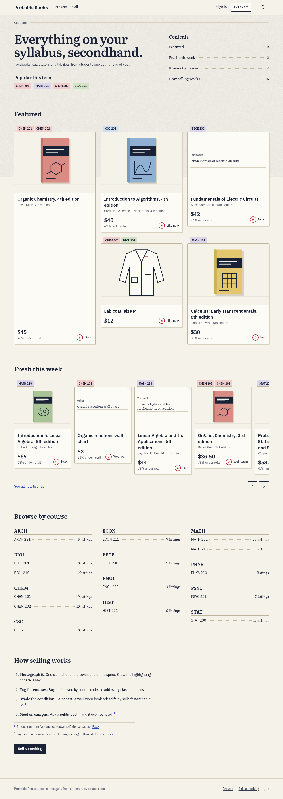
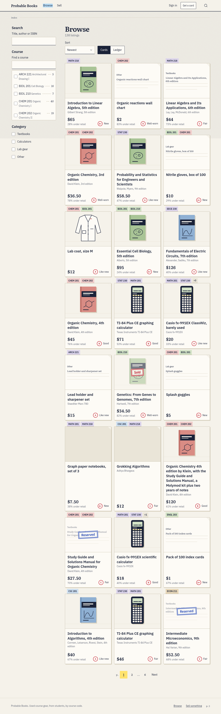
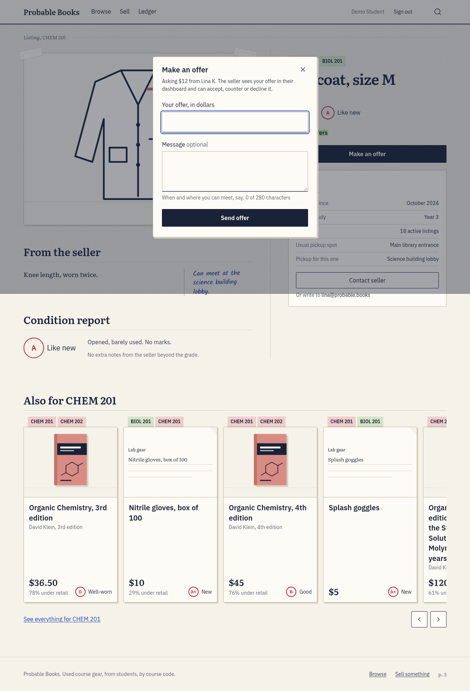
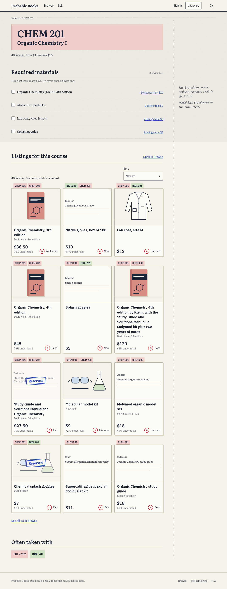
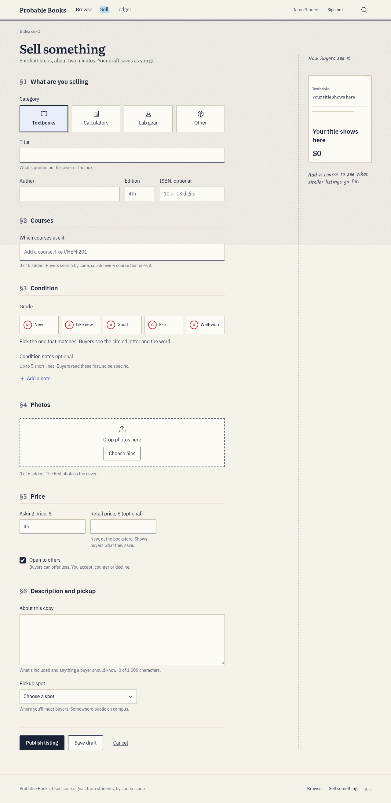
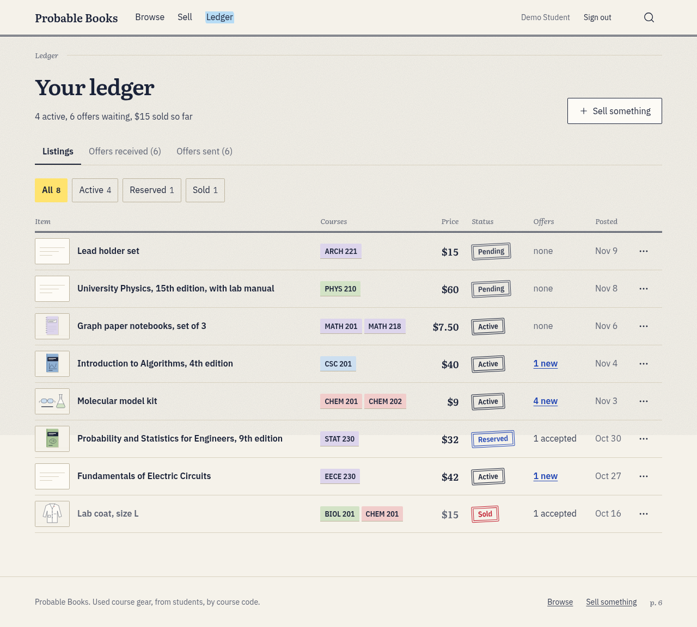
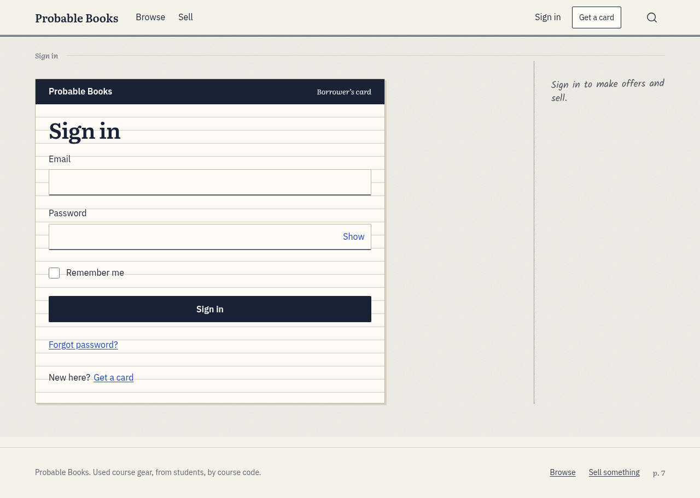
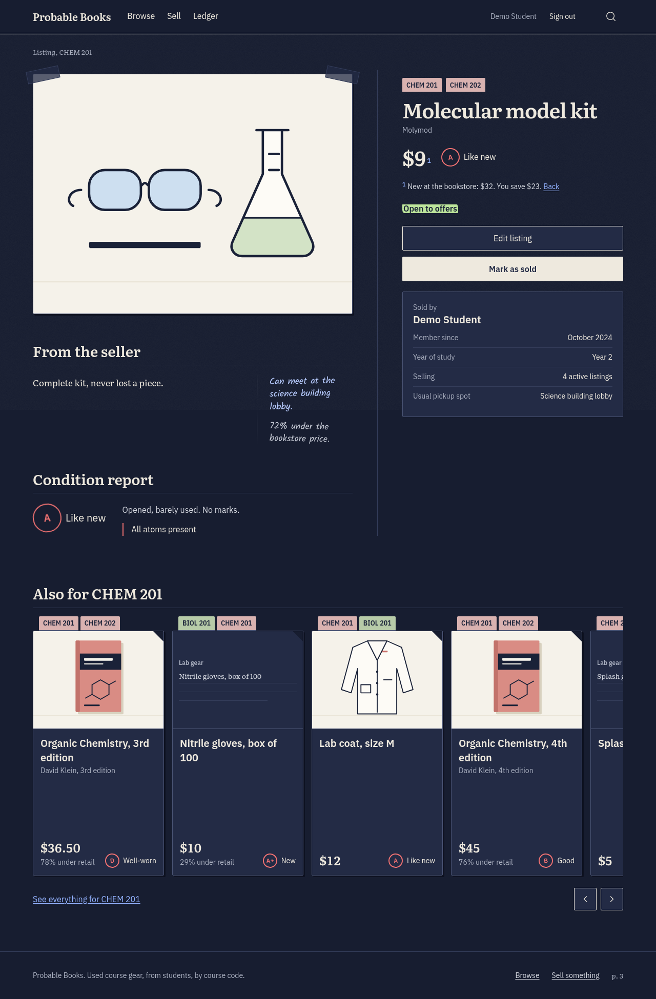

# Probable Books

A student marketplace for used textbooks, calculators and lab gear, organised by course code.
Students sell to students one year behind them. This is the frontend phase: React 19, Vite,
Tailwind 4 and a mock API. There is no backend yet.

**Live app:** <https://probable-books.netlify.app/>

Demo login: `demo@probable.books` / `password123`

## Team

| Member          | GitHub                                           | Primary pages                         |
| --------------- | ------------------------------------------------ | ------------------------------------- |
| Abbas Cherri    | [@AbbasCherri](https://github.com/AbbasCherri)   | Home, Browse                          |
| Wazan           | [@awazzan2](https://github.com/awazzan2)         | Listing Details, Course Details       |
| Youssef Elezzi  | [@yousefelezzi](https://github.com/yousefelezzi) | Sell (Create/Edit Listing), Dashboard |
| Ayk Tchelderian | [@Ayk-12](https://github.com/Ayk-12)             | Login, Register                       |

## Topic and data entities

Our assigned topic was an online marketplace. We built one for second-hand course materials on
campus, where every item is tagged with the courses that use it.

The mock data has four main entities:

| Entity      | What it holds                                                                                                                                                                                         |
| ----------- | ----------------------------------------------------------------------------------------------------------------------------------------------------------------------------------------------------- |
| **Listing** | An item for sale: title, category (textbook, calculator, lab gear, other), condition grade (A+ to D), price, retail price, photos, pickup spot, course codes, status (draft, active, reserved, sold). |
| **Course**  | A course code (for example CHEM 201) with its title, department and required materials.                                                                                                               |
| **User**    | A student account: name, email, year of study, usual pickup spot.                                                                                                                                     |
| **Offer**   | A buyer's offer on a listing: amount, message, status (pending, countered, accepted, declined, withdrawn).                                                                                            |

Money is stored as integer cents everywhere and formatted with `formatPrice()`.

## Screenshots

| Home                                    | Browse                                              |
| --------------------------------------- | --------------------------------------------------- |
|  |  |

| Listing details, making an offer                    | Course details                                       |
| --------------------------------------------------- | ---------------------------------------------------- |
|  |  |

| Sell form                               | Dashboard (ledger)                                  |
| --------------------------------------- | --------------------------------------------------- |
|  |  |

| Login                                | Night mode                                                   | Phone                                                   |
| ------------------------------------ | ------------------------------------------------------------ | ------------------------------------------------------- |
|  |  |  |

Browse filters by keyword, course, category, condition, price and whether the seller takes
offers. The filters live in the URL, so a search can be shared, and on phones they open in a
bottom sheet. A course page puts the course's required materials next to the listings tagged
with it.

Buyers make offers from a listing page. Sellers accept, counter or decline them from the
dashboard, and accepting one reserves the listing. The sell form validates as you type, shows
a live preview of the listing and keeps a draft through a reload. The same form edits existing
listings.

The reading-light toggle in the header switches to night mode. By default it follows the
system setting.

## Running the frontend locally

You need Node.js 20.19+ or 22.12+, and npm, which comes with Node. Check your version with
`node -v`.

1. Clone the repository and enter it:

   ```
   git clone https://github.com/AbbasCherri/probable-books.git
   cd probable-books
   ```

2. Install the dependencies:

   ```
   npm install
   ```

3. Start the development server:

   ```
   npm run dev
   ```

4. Open <http://localhost:5173>. Sign in with `demo@probable.books` / `password123`, or register
   a new account. In development, <http://localhost:5173/styleguide> shows every shared
   component.

To try the production build locally:

```
npm run build      # writes the static site to dist/
npm run preview    # serves dist/ at http://localhost:4173
```

No environment variables or backend are needed. All data comes from the mock API described below.

### Other scripts

```
npm test               # unit/component tests (Vitest + Testing Library), once
npm run test:watch     # same, re-running on save
npm run e2e            # Playwright, every device project (starts dev server on :5174)
npm run e2e -- --project=phone-360x800 --project=desktop-1280x800
npm run lint           # ESLint, including tests
npm run format:check   # Prettier, no writes (npm run format to fix)
```

Unit tests live next to the code as `*.test.js(x)`; render routed components with
`renderWithRouter` from `@/test/render`. E2E specs and helpers live in `e2e/`
(`e2e/helpers.spec.js` tests the helpers themselves); screenshots go to `e2e-artifacts/<project>/`.

- **Page specs** call `expectPageQuality(page, log)` from `e2e/helpers.js`. It hard-fails on more
  than one h1, horizontal overflow, serious/critical axe violations, targets under 44x44px and
  console errors.
- **The smoke spec** (`e2e/smoke.spec.js`) only hard-fails on crashes: no level-1 heading, console
  errors, wrong URL. The other checks become annotations in `playwright-report/`, and fail only
  with `E2E_STRICT=1`.

E2E environment variables:

| Variable      | Effect                                                                    |
| ------------- | ------------------------------------------------------------------------- |
| `PW_CHROMIUM` | Browser binary. Default: a system Chrome/Chromium locally, bundled in CI. |
| `PW_PORT`     | Dev-server port (default 5174), to run several checkouts side by side.    |
| `PW_REUSE=1`  | Reuse a server already on `PW_PORT` instead of starting one (not in CI).  |
| `E2E_STRICT`  | Make the smoke spec's quality checks fail the run.                        |

With no system Chrome, run `npx playwright install chromium` once.

## Team contributions

Each member owned two pages (also listed in `.github/CODEOWNERS`) plus some shared work.

**Abbas Cherri: Home and Browse.**
Home: the title page with popular courses, the featured spread, the "Fresh this week" shelf,
the course index and "How selling works". Browse: the filter panel (keyword, course, category,
condition, price, offers), the phone filter sheet, active-filter chips, results grid and
pagination, all synced to the URL. Also set up the project, the router, the mock API and seed
data, the design tokens, the `Sheet` and `Pagination` components, CI and the test setup, and
merged the page branches together on `integration/polish`.

**Wazan: Listing Details and Course Details.**
Listing Details: the image gallery, condition report, seller block, the offer dialog with
validation, the owner's mark-as-sold flow and the related-listings shelf. Course Details: the
course header, required materials and the course's listings. Also built the shared `Dialog`
component and the `useFocusTrap` hook.

**Youssef Elezzi: Sell (create/edit listing) and Dashboard.**
Sell: the listing form with category and grade pickers, a course combobox, condition notes,
photo uploader, live preview, an error summary, a price hint and a saved draft. The same form
edits existing listings. Dashboard: the seller's ledger with tabs for my listings, offers received
(accept, counter, decline) and offers sent. Also built the first set of shared layout, UI,
listing and annotation components, and the sticky-note toast.

**Ayk Tchelderian: Login and Register.**
Login: sign-in with field validation, error messages and a redirect back to the page that
needed it. Register: the sign-up form with name, email, year of study and password, with a
show/hide password field shared by both pages.

## How mock data simulates the backend

Pages never touch mock data directly. Every page calls functions in
[`src/services/api.js`](src/services/api.js) (`getListings`, `getListing`, `createListing`,
`makeOffer`, `respondToOffer`, `login`, `register` and so on). Each one returns a Promise, like
a real HTTP call. When the backend exists, these functions change and the pages don't.

- **Seed data.** [`src/services/mock/`](src/services/mock/) holds the starting data: 15 courses,
  16 users, hand-written and generated listings and offers. The seed is deterministic, so
  screenshots, tests and bug reports always see the same data. Dates are relative to when the
  data was seeded, so "posted today" stays true. The seed is loaded with a dynamic import, in
  its own chunk.
- **A database in the browser.** On first load the seed is copied into an in-memory database
  and saved to `localStorage` (`pb.db.v2`) after every write. Listings you create, offers you
  make and accounts you register survive a page reload, and each browser has its own copy.
  Changing the seed bumps a version number, and stored data from an older version is replaced.
- **Network behaviour.** Every call waits 250–600 ms, like a network round trip, so you see the
  loading skeletons in use. Errors are thrown as an `ApiError` with an
  HTTP-style status (401 not signed in, 403 not yours, 404 not found, 422 invalid input, with
  per-field messages that forms show next to each input).
- **Business rules.** The mock enforces the rules a server would: only the seller can edit a
  listing or answer an offer, you cannot make an offer on your own listing, a counter-offer has
  to fall between the offer and the asking price, and accepting an offer marks the listing
  reserved.
- **Sessions.** `login` and `register` store the signed-in user's id under `pb.session`.
  `/sell`, `/listings/:id/edit` and `/dashboard` redirect to the login page when nobody is
  signed in. Demo passwords sit in the seed as plain text. This is not real authentication.
- **Photos.** Photos you add stay in the browser as object URLs and are never uploaded, so a new
  listing's photos are gone after a reload.

Developer switches, set in the browser console:

```js
localStorage['pb.mock.latency'] = '0' // no delay (any number of ms)
localStorage['pb.mock.fail'] = 'getListings,makeOffer' // those calls fail with a 500 ('*' = all, dev only)
localStorage.removeItem('pb.db.v2') // reset to the seed on the next reload
```

## Deploying

`npm run build` writes a static site to `dist/`. Every route is client-side, so the host must
answer unknown paths with `index.html`: `public/_redirects` (`/* /index.html 200`) does that on
Netlify, where the live app is hosted, and on Cloudflare Pages. On another host, add the
equivalent rewrite (Vercel: a `vercel.json` with
`{ "rewrites": [{ "source": "/(.*)", "destination": "/index.html" }] }`).

See [CONTRIBUTING.md](CONTRIBUTING.md) for the team workflow.
