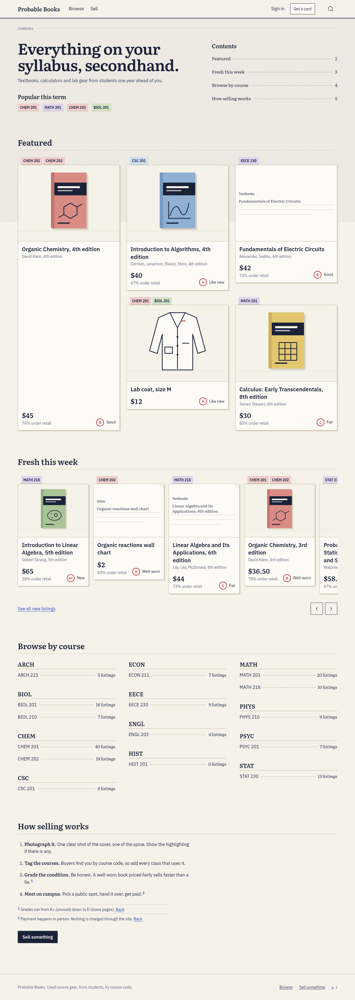
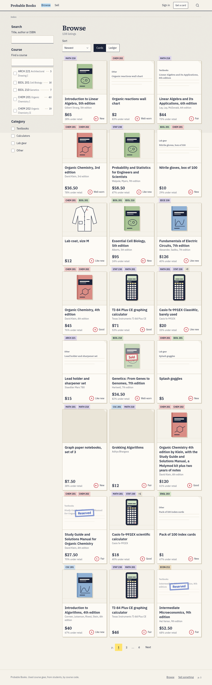
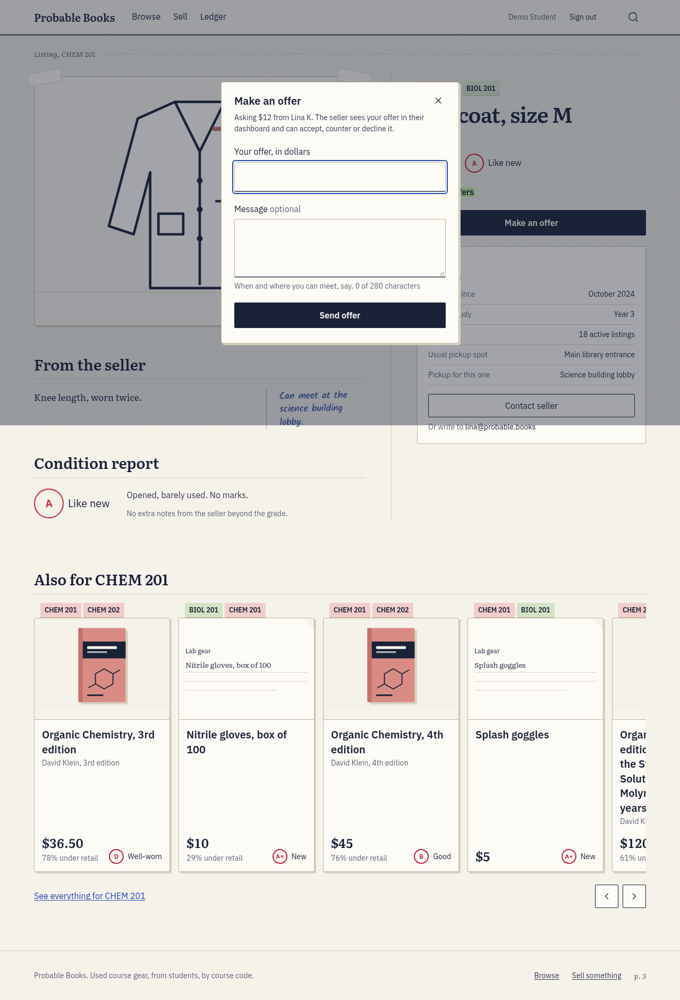
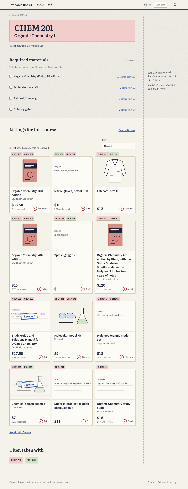
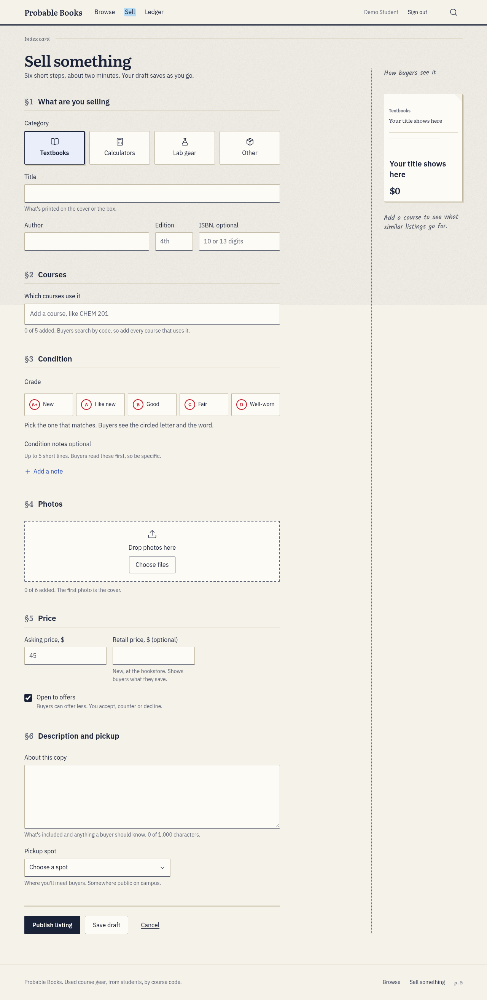
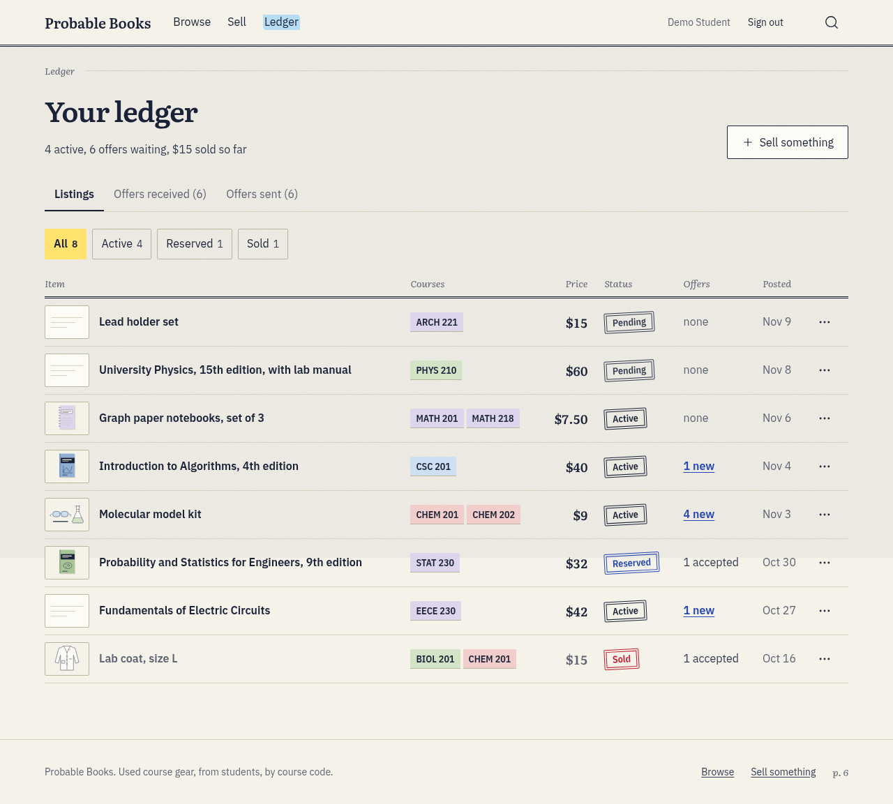
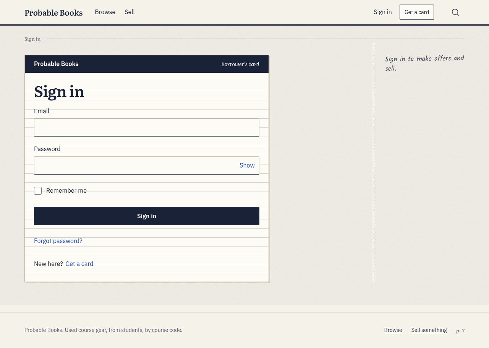
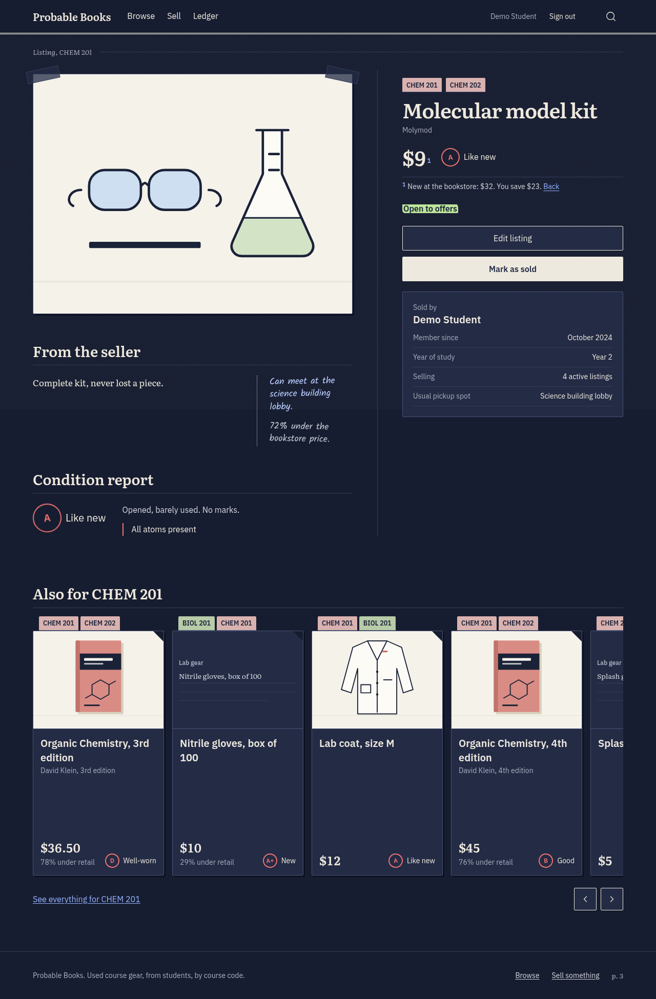

# Probable Books

A student marketplace for used textbooks, calculators and lab gear, organised by course code.
Students sell to students one year behind them. This is the frontend phase: React 19, Vite,
Tailwind 4 and a mock API. There is no backend yet.

**Live app:** <https://probable-books.netlify.app/>

Demo login: `demo@probable.books` / `password123`

## Team

| Member          | GitHub                                           | Primary pages                         |
| --------------- | ------------------------------------------------ | ------------------------------------- |
| Abbas Cherri    | [@AbbasCherri](https://github.com/AbbasCherri)   | Home, Browse                          |
| Wazan           | [@awazzan2](https://github.com/awazzan2)         | Listing Details, Course Details       |
| Youssef Elezzi  | [@yousefelezzi](https://github.com/yousefelezzi) | Sell (Create/Edit Listing), Dashboard |
| Ayk Tchelderian | [@Ayk-12](https://github.com/Ayk-12)             | Login, Register                       |

## Topic and data entities

Our assigned topic was an online marketplace. We built one for second-hand course materials on
campus, where every item is tagged with the courses that use it.

The mock data has four main entities:

| Entity      | What it holds                                                                                                                                                                                         |
| ----------- | ----------------------------------------------------------------------------------------------------------------------------------------------------------------------------------------------------- |
| **Listing** | An item for sale: title, category (textbook, calculator, lab gear, other), condition grade (A+ to D), price, retail price, photos, pickup spot, course codes, status (draft, active, reserved, sold). |
| **Course**  | A course code (for example CHEM 201) with its title, department and required materials.                                                                                                               |
| **User**    | A student account: name, email, year of study, usual pickup spot.                                                                                                                                     |
| **Offer**   | A buyer's offer on a listing: amount, message, status (pending, countered, accepted, declined, withdrawn).                                                                                            |

Money is stored as integer cents everywhere and formatted with `formatPrice()`.

## Screenshots

| Home                                    | Browse                                              |
| --------------------------------------- | --------------------------------------------------- |
|  |  |

| Listing details, making an offer                    | Course details                                       |
| --------------------------------------------------- | ---------------------------------------------------- |
|  |  |

| Sell form                               | Dashboard (ledger)                                  |
| --------------------------------------- | --------------------------------------------------- |
|  |  |

| Login                                | Night mode                                                   | Phone                                                   |
| ------------------------------------ | ------------------------------------------------------------ | ------------------------------------------------------- |
|  |  |  |

Browse filters by keyword, course, category, condition, price and whether the seller takes
offers. The filters live in the URL, so a search can be shared, and on phones they open in a
bottom sheet. A course page puts the course's required materials next to the listings tagged
with it.

Buyers make offers from a listing page. Sellers accept, counter or decline them from the
dashboard, and accepting one reserves the listing. The sell form validates as you type, shows
a live preview of the listing and keeps a draft through a reload. The same form edits existing
listings.

The reading-light toggle in the header switches to night mode. By default it follows the
system setting.

## Running the frontend locally

You need Node.js 20.19+ or 22.12+, and npm, which comes with Node. Check your version with
`node -v`.

1. Clone the repository and enter it:

   ```
   git clone https://github.com/AbbasCherri/probable-books.git
   cd probable-books
   ```

2. Install the dependencies:

   ```
   npm install
   ```

3. Start the API first (see [`server/README.md`](server/README.md) for its one-time database
   setup), then the web app:

   ```
   cd server && npm install && npm run dev    # API on http://localhost:4000
   cd .. && npm run dev                       # web app on http://localhost:5173
   ```

4. Open <http://localhost:5173>. Sign in with `demo@probable.books` / `password123`, or register
   a new account. In development, <http://localhost:5173/styleguide> shows every shared
   component.

To try the production build locally:

```
npm run build      # writes the static site to dist/
npm run preview    # serves dist/ at http://localhost:4173
```

No environment variables are needed in development: Vite forwards every `/api` request to the
API on port 4000 (set `API_PROXY_TARGET` to use another address).

### Other scripts

```
npm test               # unit/component tests (Vitest + Testing Library), once
npm run test:watch     # same, re-running on save
npm run e2e            # Playwright, every device project (starts dev server on :5174)
npm run e2e -- --project=phone-360x800 --project=desktop-1280x800
npm run lint           # ESLint, including tests
npm run format:check   # Prettier, no writes (npm run format to fix)
```

Unit tests live next to the code as `*.test.js(x)`; render routed components with
`renderWithRouter` from `@/test/render`. E2E specs and helpers live in `e2e/`
(`e2e/helpers.spec.js` tests the helpers themselves); screenshots go to `e2e-artifacts/<project>/`.

- **Page specs** call `expectPageQuality(page, log)` from `e2e/helpers.js`. It hard-fails on more
  than one h1, horizontal overflow, serious/critical axe violations, targets under 44x44px and
  console errors.
- **The smoke spec** (`e2e/smoke.spec.js`) only hard-fails on crashes: no level-1 heading, console
  errors, wrong URL. The other checks become annotations in `playwright-report/`, and fail only
  with `E2E_STRICT=1`.

E2E environment variables:

| Variable      | Effect                                                                    |
| ------------- | ------------------------------------------------------------------------- |
| `PW_CHROMIUM` | Browser binary. Default: a system Chrome/Chromium locally, bundled in CI. |
| `PW_PORT`     | Dev-server port (default 5174), to run several checkouts side by side.    |
| `PW_REUSE=1`  | Reuse a server already on `PW_PORT` instead of starting one (not in CI).  |
| `E2E_STRICT`  | Make the smoke spec's quality checks fail the run.                        |

With no system Chrome, run `npx playwright install chromium` once.

## Team contributions

Each member owned two pages (also listed in `.github/CODEOWNERS`) plus some shared work.

**Abbas Cherri: Home and Browse.**
Home: the title page with popular courses, the featured spread, the "Fresh this week" shelf,
the course index and "How selling works". Browse: the filter panel (keyword, course, category,
condition, price, offers), the phone filter sheet, active-filter chips, results grid and
pagination, all synced to the URL. Also set up the project, the router, the mock API and seed
data, the design tokens, the `Sheet` and `Pagination` components, CI and the test setup, and
merged the page branches together on `integration/polish`.

**Wazan: Listing Details and Course Details.**
Listing Details: the image gallery, condition report, seller block, the offer dialog with
validation, the owner's mark-as-sold flow and the related-listings shelf. Course Details: the
course header, required materials and the course's listings. Also built the shared `Dialog`
component and the `useFocusTrap` hook.

**Youssef Elezzi: Sell (create/edit listing) and Dashboard.**
Sell: the listing form with category and grade pickers, a course combobox, condition notes,
photo uploader, live preview, an error summary, a price hint and a saved draft. The same form
edits existing listings. Dashboard: the seller's ledger with tabs for my listings, offers received
(accept, counter, decline) and offers sent. Also built the first set of shared layout, UI,
listing and annotation components, and the sticky-note toast.

**Ayk Tchelderian: Login and Register.**
Login: sign-in with field validation, error messages and a redirect back to the page that
needed it. Register: the sign-up form with name, email, year of study and password, with a
show/hide password field shared by both pages.

## How the frontend talks to the backend

Pages never call `fetch` themselves. Every page calls functions in
[`src/services/api.js`](src/services/api.js) (`getListings`, `createListing`, `makeOffer`,
`respondToOffer`, `login`, `uploadPhoto` and so on), and those go to the API through one request
layer, [`src/services/http.js`](src/services/http.js).

- **The server decides.** Validation, ownership, offer rules and course statistics all run on
  the server. Forms still check input as you type, but only for quick feedback.
- **Sessions.** `login` and `register` keep the server's token in `localStorage` (`pb.token`) and
  send it as `Authorization: Bearer ...`. When the server answers 401 to a stored token (expired,
  or the account was deleted), the token is dropped and the app treats you as signed out.
  Tabs stay in step: signing in, out or switching account in one tab updates the others. A build
  with `VITE_AUTH_STORAGE=session` keeps the token per tab (`sessionStorage`) instead, so several
  testers can use different accounts in one browser. Use it on the dev site only.
  `/sell`, `/listings/:id/edit` and `/dashboard` then send you to the login page.
- **Errors.** Every failure becomes an `ApiError` with the HTTP status, the server's message,
  per-field messages for 422s (forms show them next to each input) and suggested courses for an
  unknown course code. A network failure has status 0.
- **Photos.** The Sell form uploads new photos to `POST /api/uploads` when you save, and the
  listing keeps the addresses the server returns, so photos survive a reload.

### The mock API (tests only)

[`src/services/mock/`](src/services/mock/) holds the demo data (the server's seed script loads
the same data into Postgres) and `mockApi.js`, an in-memory stand-in that follows the server's
rules. Unit tests and the Playwright UI suite switch it on with `VITE_API_MOCK=1`, so they need no
server and every browser gets its own copy of the data. The flag is fixed at build time, so the
mock is never part of the app's bundle.

## Deploying

`npm run build` writes a static site to `dist/`. Every route is client-side, so the host must
answer unknown paths with `index.html`: `public/_redirects` (`/* /index.html 200`) does that on
Netlify, where the live app is hosted, and on Cloudflare Pages. On another host, add the
equivalent rewrite (Vercel: a `vercel.json` with
`{ "rewrites": [{ "source": "/(.*)", "destination": "/index.html" }] }`).

Build the web app with `VITE_API_URL` set to the deployed API's address (for example
`VITE_API_URL=https://probable-books-api.example npm run build`). On the API, set `CORS_ORIGIN` to
the web app's address and `PUBLIC_API_URL` to the API's own public address (used in photo links).

## Backend (Phase 2, in progress)

The backend (Node 22, Express, PostgreSQL) lives in [`server/`](server/). Setup and file
ownership are in [`server/README.md`](server/README.md).

### Running the whole project locally

1. Set up the API and its demo data as described in [`server/README.md`](server/README.md), then
   start it with `npm run dev` inside `server/` (port 4000).
2. In the repository root, run `npm install` and `npm run dev`. Vite forwards `/api` to the API,
   so no `.env` file is needed.
3. Open <http://localhost:5173>. Every page now reads from and writes to the API.

Interactive API documentation is at <http://localhost:4000/api/docs> (JSON at `/api/docs.json`).

### Abbas

#### API docs

All three are Public (no token). Responses use the Listing shape from the requirements (A6).
Unknown filter values are ignored, so none of them has its own failure case; any unexpected
failure is `500 { "message": "Something went wrong. Try again." }`.

| Method | Path                     | Request                                                                                                                                                                                                                                   | Response                                                        |
| ------ | ------------------------ | ----------------------------------------------------------------------------------------------------------------------------------------------------------------------------------------------------------------------------------------- | --------------------------------------------------------------- |
| GET    | `/api/listings`          | Query: `q`, `course`, `category`, `condition` (repeat or comma-separate for OR), `minPrice`, `maxPrice` (cents), `openToOffers=true`, `sort` (`newest`, `price_asc`, `price_desc`, `condition`), `page`, `pageSize` (default 24, max 100) | `200 { items: Listing[], total, page, pageSize }`, no drafts    |
| GET    | `/api/listings/featured` | None                                                                                                                                                                                                                                      | `200 Listing[]`: up to 5 active featured listings, newest first |
| GET    | `/api/listings/new`      | Query: `limit` (default 10, clamped to 1..50)                                                                                                                                                                                             | `200 Listing[]`: newest active listings                         |
| GET    | `/api/health`            | None                                                                                                                                                                                                                                      | `200 { status: "ok" }`, or 500 when the database is unreachable |
| GET    | `/api/docs`              | None                                                                                                                                                                                                                                      | Swagger UI page; `/api/docs.json` is the OpenAPI document       |

#### Contributions

Phase 1: project scaffolding, design tokens, the mock data and mock API, shared UI components,
CI and the test setup. Phase 2: the PostgreSQL schema on Neon with its migration runner and
seed script, the API platform (error format, request log, CORS, security headers, router
layout), the interactive documentation with the shared data shapes, the browse endpoints, the
health check, and switching Home and Browse over to the live API.

#### Challenges

Stable paging across sorts. Sorting by price or condition alone leaves ties, and Postgres may
return tied rows in a different order on each query, so page 2 could repeat or skip a listing
from page 1. Every sort now ends with `created_at DESC, id ASC`, which makes the order total;
a test walks every sort with page sizes 13 and 50 and checks both give the same sequence with
no repeats or gaps.

### Wazan

#### API docs

All paths are under `/api`. Errors use the shared format (`{ message, fields?, closest? }`).
The interactive versions, with every response shape, are on `/api/docs`.

| Method and path             | Access   | Request                                                     | Success                                       | Failures                                                                                                                                                                                                                       |
| --------------------------- | -------- | ----------------------------------------------------------- | --------------------------------------------- | ------------------------------------------------------------------------------------------------------------------------------------------------------------------------------------------------------------------------------ |
| `GET /listings/:id`         | Optional | none                                                        | 200 Listing detail: the listing plus `seller` | 404 "This page was torn out." (unknown, or someone else's draft)                                                                                                                                                               |
| `GET /courses`              | Public   | none                                                        | 200 every Course with `listingCount`, by code | none                                                                                                                                                                                                                           |
| `GET /courses/:code`        | Public   | `:code` in any spelling (`CHEM-201`, `chem201`, `CHEM 201`) | 200 Course detail with `stats`                | 404 "No CHEM 999 in the index." with `closest`                                                                                                                                                                                 |
| `POST /listings/:id/offers` | Required | `{ amountCents, message? }`                                 | 201 the new pending Offer                     | 401 not signed in; 404 unknown or someone else's draft; 422 own listing, not active (reserved, sold, draft), not open to offers, already a pending offer, `fields.amountCents`, `fields.message` (first failure in that order) |
| `GET /offers?direction=`    | Required | `direction`: `received` (default) or `sent`                 | 200 Offers with context, newest first         | 401 not signed in; 422 `fields.direction` "Use received or sent."                                                                                                                                                              |

Notes:

- `seller.email` is only sent when the request carries a valid token, for "Contact seller".
  `seller.activeListingCount` counts the seller's active listings, including this one if active.
- `GET /courses` may answer with data up to 60 seconds old, because the header lookup calls it
  every time it opens.
- Course stats (`listingCount`, `minCents`, `medianCents`) cover active listings only. The median
  is rounded to a whole cent; with no listings both prices are `null`.
- In `GET /offers?direction=sent`, `listing` is `null` if its seller has turned it back into a
  draft, so drafts stay private.

Code: `server/src/routes/listings.detail.js`, `courses.js` and `offers.create.js`, with tests in
`server/tests/` (`npm test` in `server/`, against the database in `DATABASE_URL`).

#### Contributions

Phase 1: the Listing Details and Course Details pages, plus the shared `Dialog` and the
`useFocusTrap` hook (see Team contributions above). Phase 2: the buyer's side of the API. One
listing with its seller, the course index and course details with price statistics, making an
offer, and the list of a user's offers that fills the Dashboard tabs. Each endpoint has its
OpenAPI entry and a test for every success and failure listed in the requirements.

#### Challenges

**Two offers at the same moment.** A buyer may have only one pending offer per listing, but
checking "is there one already?" and then inserting is not safe: two requests can both pass the
check before either inserts. The fix is in the database. A partial unique index
(`offers_one_pending_per_buyer`) lets only one pending row through, and the endpoint turns the
losing request's unique-violation error into the normal "You already have an offer waiting"
message. A test fires two identical offers together and expects exactly one 201 and one 422.
The listing row is also read with `FOR SHARE`, so an offer can't slip onto a listing that a
seller is reserving at that moment.

**Error order matches the spec.** The requirements list the offer failures in a fixed order and
report only the first, so a sold listing with a bad amount must say "This listing is sold.", not
the amount error. The listing checks run first and the body checks last, and a test pins the order.

### Youssef

#### API docs

All paths are under `/api` and every endpoint needs a token. Errors use the shared format
(`{ message, fields? }`); a missing or bad token answers `401 "Sign in to continue."`. The
interactive versions are on `/api/docs`.

| Method and path        | Access      | Request                                                                                                                 | Success                                                                         | Failures                                                                                                                                                                                                                                                                                                                     |
| ---------------------- | ----------- | ----------------------------------------------------------------------------------------------------------------------- | ------------------------------------------------------------------------------- | ---------------------------------------------------------------------------------------------------------------------------------------------------------------------------------------------------------------------------------------------------------------------------------------------------------------------------- |
| `POST /listings`       | Required    | Listing fields (`title`, `category`, `courseCodes`, `condition`, `priceCents`, `pickupSpot`, optional extras, `status`) | 201 the new Listing (`featured` false, `sellerId` = caller)                     | 422 one `fields` entry per broken rule, all reported at once; `fields.status` "New listings start as a draft or active." for reserved or sold                                                                                                                                                                                |
| `PATCH /listings/:id`  | Owner       | Only the fields that change, including `status` (`draft`, `active`, `reserved`, `sold`)                                 | 200 the full updated Listing, `updatedAt` now                                   | 403 "That listing is not yours."; 404 "This page was torn out." (unknown, or someone else's draft); 422 per field, checked on the listing as it would be after the change                                                                                                                                                    |
| `DELETE /listings/:id` | Owner       | none                                                                                                                    | 204; every offer on the listing is removed with it                              | 403 "That listing is not yours."; 404 "This page was torn out."                                                                                                                                                                                                                                                              |
| `GET /listings/mine`   | Required    | none                                                                                                                    | 200 My listings: every status including drafts, newest first, with `offerCount` | none beyond 401                                                                                                                                                                                                                                                                                                              |
| `PATCH /offers/:id`    | Participant | `{ action }`: `accept`, `decline`, `counter` (with `counterCents`) or `withdraw`                                        | 200 the updated Offer                                                           | 404 "Offer not found."; 403 not yours, or the wrong party for the action ("Only the seller can counter.", "Only the seller can accept or decline a pending offer.", "Only the buyer can withdraw an offer."); 422 "Unknown action.", "This offer is no longer open.", listing reserved, sold or draft, `fields.counterCents` |

Notes:

- Title, category, courses, condition, price and pickup spot are required unless the listing is a
  draft. A draft may leave them out, but anything it includes must still be valid, so an
  incomplete draft saves and cannot be published until it is complete.
- Course codes are accepted in any spelling (`chem201`, `CHEM-201`), stored as `CHEM 201`, with
  duplicates removed and unknown codes rejected. ISBNs are checked (ISBN-10 and ISBN-13 check
  digits) and returned as digits only. `pickupSpot` defaults to "Science building lobby".
- Server-owned properties in a request (`id`, `sellerId`, `featured`, dates) are ignored.
- Who may do what with an offer: the seller accepts, declines or counters a pending offer; the
  buyer withdraws a pending or countered offer, or accepts or declines a counter. Accepting
  reserves the listing in the same transaction and never changes the other offers.
- A counter must be strictly above the offer and strictly below the asking price. When the buyer
  accepts a counter, the agreed price is `counterCents`.

Code: `server/src/routes/listings.write.js`, `listings.validate.js` and `offers.respond.js`, with
tests in `server/tests/listings.write.test.js` and `offers.respond.test.js`.

#### Contributions

Phase 1: the Sell form (create and edit) and the Dashboard ledger, plus the first shared layout,
UI, listing and annotation components and the sticky-note toast (see Team contributions above).
Phase 2: the seller's side of the API. Creating, editing, publishing, reserving, selling and
deleting listings with the ownership checks, the "My listings" list with pending offer counts,
and answering offers (accept, decline, counter, withdraw). Every field rule uses the exact
message from the requirements, each endpoint has its OpenAPI entry, and 88 tests cover each
success and failure, every row of the offer actions table and the concurrent cases.

#### Challenges

**Two accepts at the same moment.** Accepting an offer has to mark the offer accepted and the
listing reserved together, and two quick clicks (or two open tabs) must never reserve one listing
for two buyers. Reading "is the listing active?" and then updating is not safe, because both
requests can pass the check. The endpoint runs in one transaction and locks the listing row
(`SELECT ... FOR UPDATE`) before it reads the offer, so a second accept waits, then sees the
listing is reserved and gets "This listing is reserved for another buyer." Locking the listing
before the offer in every path also keeps two requests from deadlocking. A test fires two accepts
together and expects exactly one 200 and one 422.

**Checking an edit against the whole listing.** A PATCH sends only the fields that change, but
the rules depend on each other: lowering the price can break "retail must be above the asking
price", and publishing a draft must apply every required-field rule. Validating only the sent
fields missed these cases. The endpoint now lays the changes over the stored listing and runs the
same validator as create on the result, using draft rules only when the resulting status is
draft. To check that this did not break existing data, every one of the 140 seeded listings was
re-saved through the endpoint and passed.

### Ayk

#### API docs

Responses use the User shapes from the requirements (A6). A failed form answers
`422 { message, fields }`; a missing or bad token on a Required endpoint answers
`401 { "message": "Sign in to continue." }`.

| Method | Path                 | Access   | Request                                                                               | Response                                                                                                 |
| ------ | -------------------- | -------- | ------------------------------------------------------------------------------------- | -------------------------------------------------------------------------------------------------------- |
| POST   | `/api/auth/register` | Public   | `{ name, email, password, yearOfStudy? }` (password at least 8 characters)            | `201 { user, token }`; 422 per field, or the email is taken; 429 after 10 attempts in 15 minutes         |
| POST   | `/api/auth/login`    | Public   | `{ email, password }` (email ignores capitalisation and spaces)                       | `200 { user, token }`; `401 "That email and password don't match."`; 429 after 10 failures in 15 minutes |
| GET    | `/api/auth/me`       | Required | None                                                                                  | `200` User (self)                                                                                        |
| POST   | `/api/auth/logout`   | Public   | None                                                                                  | `204`, always                                                                                            |
| GET    | `/api/users/:id`     | Public   | None                                                                                  | `200` User (public) plus `activeListingCount`; `404 "User not found."`                                   |
| PATCH  | `/api/users/me`      | Required | Any of `name`, `yearOfStudy`, `usualPickupSpot`; `currentPassword` with `newPassword` | `200` User (self); 422 per field, `"That isn't your current password."`                                  |
| DELETE | `/api/users/me`      | Required | None                                                                                  | `204`; the account, its listings and every related offer are removed                                     |
| POST   | `/api/uploads`       | Required | multipart field `photo`: one JPEG, PNG or WebP, at most 5 MB                          | `201 { url }`, a public permanent address; 422 for wrong type, too large or no file                      |
| GET    | `/api/uploads/:id`   | Public   | None                                                                                  | The image; `404 "Photo not found."`                                                                      |

#### Contributions

#### Challenges

See [CONTRIBUTING.md](CONTRIBUTING.md) for the team workflow.
